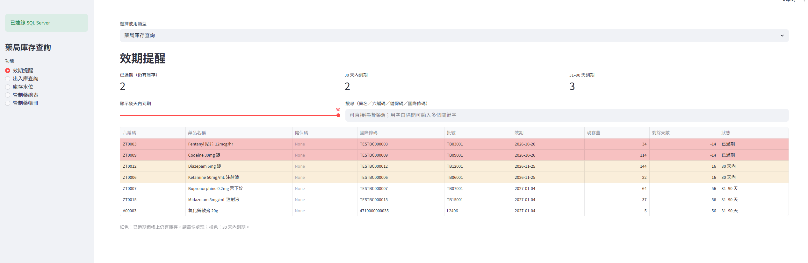
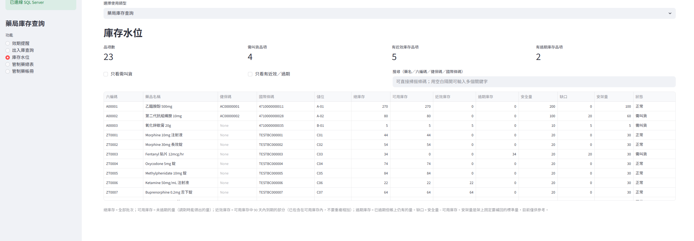
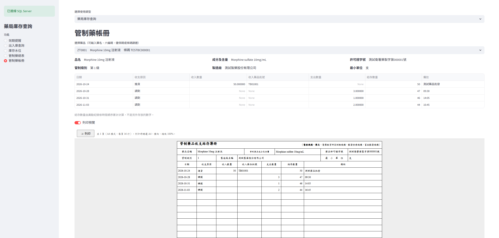

# 藥局庫存與管制藥帳冊管理系統

以 **SQL Server + Python + Streamlit** 建立的社區藥局庫存管理原型：效期與庫存水位、出入庫查詢、管制藥帳冊（含仿紙本列印預覽）、健保藥品與替代藥品查詢、健保資料匯入、盤點表上傳。

> 這是**個人學習與作品集專案**，由一位社區藥局藥師開發，尚未用於實際藥局營運。
> 專案中的藥品、員工、庫存、管制藥資料皆為**虛構的示範資料**；健保資料來自健保署公開下載的檔案。



---

## 功能

| 區塊 | 功能 |
|---|---|
| 藥局庫存查詢 | 效期提醒（已過期、30 天內、31–90 天）、庫存水位（總庫存／可用庫存／近效庫存／過期庫存／需叫貨）、出入庫查詢（入庫／出庫／總查詢，可依年／季／月／日統計）、管制藥總表與批號管理 |
| 管制藥帳冊 | 依藥品列出收支、結存（由異動紀錄依時間順序累計，不是另外存的數字）；仿紙本帳冊的**列印預覽**（A4 橫式，可存成 PDF） |
| 健保藥品查詢 | 以健保碼、藥名（中英文）、成分、藥商、劑型、ATC 查詢；「給付中」或「歷次異動」兩種檢視；價格歷史與品項資料 |
| 替代藥品查詢 | 只列本藥局有登錄的藥；**成分相同排最前、ATC 相同次之**，含量與劑型一併列出，由藥師自行判斷 |
| 資料維護 | ① 藥品總表新增／修改／停用（含管制藥必填欄位檢查）　② 健保整批檔預覽與匯入、資料檢查　③ 盤點表下載、上傳、預覽差異、寫入盤盈／盤虧 |

> 尚未完成：調劑與出入庫的寫入頁、缺藥紀錄、多品項比較（畫面上標示「開發中」）。




---

## 技術與資料來源

- 資料庫：SQL Server Express（T-SQL：檢視表、預存程序、交易、篩選索引、視窗函式）
- 後端與介面：Python 3、Streamlit、pandas、pyodbc、openpyxl
- 示範模式：SQLite（不需要安裝 SQL Server，可直接試用）
- 健保資料：健保署「健保用藥品項」整批下載檔（`all1_YYYYM_1.TXT`、`_2.TXT`，Big5 固定寬度文字檔）

---

## 設計重點

| 決定 | 原因 |
|---|---|
| 庫存不存成欄位，只記**異動**（進貨為正、出庫為負），現存量由加總算出 | 避免「庫存欄位」與「異動紀錄」對不起來；任何數字都能回溯到哪一筆異動 |
| 計算規則放在**檢視表**（可用庫存、近效庫存、結存、出入庫歸類） | 規則只寫一次，各頁面一致；Python 只負責查詢與排版 |
| 資料庫用**約束**擋錯誤資料（異動類型、數量正負、管制藥必填欄位、健保碼不可重複） | 即使繞過介面，錯誤資料也寫不進去 |
| 調劑用**先到期先出（FEFO）**，在同一個交易、SERIALIZABLE 隔離層級內完成，排除過期批次 | 避免兩人同時調劑同一藥品而超扣 |
| 健保價格有**生效期間**，不覆蓋舊資料；藥品總表的健保價是由歷史表同步的「目前價格」 | 可查任一天當時的價格、比對漲跌 |
| 健保價 0.00 視為「無給付價」，不當成目前價格 | 避免把藥局帳上的健保價洗成 0 |
| 匯入程式**只新增與更新，不刪除**；先預覽再寫入；可重複執行；寫入失敗整批還原 | 部分檔案也不會弄壞資料 |
| 藥品**不刪除，只停用** | 歷史異動與管制帳冊要能對回藥品 |
| 盤點以**批次**為單位；寫入前再核對一次帳面數量 | 預覽之後若有人調劑或進貨，會拒絕寫入、要求重新預覽 |

### 主要資料表

`藥品總表`、`效期表`（批次）、`庫存異動表`、`員工`、`廠商表`（向誰進貨）、`製造商表`、`健保藥品品項`、`健保價格歷史`、`健保匯入紀錄`

### 主要檢視表

`v_批次庫存`、`v_藥品庫存`、`v_近效期`、`v_異動明細`、`v_管制藥清單`、`v_管制藥批次`、`v_管制帳冊`、`v_現行健保價`、`v_健保價核對`、`v_本藥局成分`

---

## 專案結構

```
.
├── app.py                 Streamlit 主程式（頁面分派與庫存查詢各頁）
├── db.py                  資料庫連線層（SQL Server／SQLite 示範模式、查詢、交易）
├── nhi_page.py            健保藥品查詢、替代藥品查詢
├── maintenance_page.py    資料維護（總表、健保匯入、盤點）
├── print_ledger.py        管制藥帳冊列印預覽
├── import_nhi_txt.py      健保整批檔（固定寬度）解析與匯入
├── import_nhi.py          匯入核心邏輯（比對、寫入、價格歷史）
├── make_demo_db.py        產生虛構資料的示範資料庫（SQLite）
├── test_conn.py           測試能否連上 SQL Server
├── requirements.txt
├── run.bat.example        啟動範例（請複製成 run.bat 並改成自己的路徑）
└── sql/
    ├── 藥局資料庫建檔.sql        建立資料表、檢視表、預存程序
    └── test_data_controlled.sql  虛構的管制藥測試資料（選用）
```

---

## 快速試用（示範模式，不需要 SQL Server）

```bash
pip install -r requirements.txt
python make_demo_db.py        # 產生 demo.db（虛構資料）
streamlit run app.py
```

沒有設定環境變數時，程式會使用示範資料庫，畫面左側會顯示「示範模式」。

> 示範資料庫只含簡化的資料表與檢視表，管制藥帳冊、健保資料等功能需要連 SQL Server 才完整。

---

## 連接 SQL Server

1. 安裝 SQL Server Express、SSMS，以及 **Microsoft ODBC Driver 18 for SQL Server**。
2. 在 SSMS 執行 `sql/藥局資料庫建檔.sql`，建立資料庫「藥局庫存」。
   > ⚠️ 這個檔案開頭會 `DROP` 舊的資料表，**只適合全新或可以清空的資料庫**。已有真實資料時不要整份重跑。
3. 設定環境變數後啟動（PowerShell）：

```powershell
$env:PHARMACY_DB   = "sqlserver"
$env:PHARMACY_ODBC = "DRIVER={ODBC Driver 18 for SQL Server};SERVER=localhost\SQLEXPRESS;DATABASE=藥局庫存;Trusted_Connection=yes;TrustServerCertificate=yes;"
streamlit run app.py
```

可先執行 `python test_conn.py` 確認連線。

---

## 匯入健保資料

1. 到健保署網站「健保用藥品項」下載整批檔（`all1_YYYYM_1.TXT`、`all1_YYYYM_2.TXT`），放在專案資料夾。檔案約 200 MB，**不要放進 git**（已在 `.gitignore`）。
2. 在「資料維護 → 健保資料庫更新與維護」選檔、**預覽**、確認後匯入；或用指令：

```powershell
python import_nhi_txt.py all1_11511_1.TXT all1_11511_2.TXT --data-date 115/11/01 --dry-run   # 先預覽
python import_nhi_txt.py all1_11511_1.TXT all1_11511_2.TXT --data-date 115/11/01 --fast      # 確認後匯入
```

約 22 萬列價格、4.5 萬個品項。官方每月更新，每月重複同樣步驟即可（只會新增與更新）。

---

## 已知限制

- **欄位意義部分是推測：** 整批檔沒有官方欄位說明，欄位位置由樣本檔逆向推得。其中位置 14 的 Y/N 當作「複方／單方」、位置 767 的代碼（1–4）原樣存成「藥品分類」，意義未確認；匯入的「藥商」欄在進口藥可能是國外原廠名稱，不一定是國內代理商。
- 健保價 `0.00` 與價格欄為「-」的品項，被視為「無給付價／無價格」，這是推測，並非官方定義。
- 調劑、出入庫的寫入頁尚未完成（資料庫的 `sp_調劑` 預存程序已寫好）。
- **沒有登入與權限控制**，也沒有多人同時使用的測試，只適合在自己的電腦上使用，不要對外開放。
- 沒有自動化測試套件（開發期間以 Streamlit 的 AppTest 與示範資料手動驗證）。
- 「資料維護」會寫入資料庫：**第一次使用前請先備份**，並先用少量資料試。

---

## 開發方式說明

本專案由藥師（本人）負責**需求定義、藥局流程與規則的判斷、資料驗證與驗收**；程式的撰寫大量借助 AI（Claude）協作完成，開發過程中我逐步檢查結果、找出錯誤並調整。
我不會宣稱所有程式碼都由我獨立撰寫；其中資料庫設計與藥局規則（管制帳冊格式、出入庫歸類、盤點流程、替代藥的排序）是專案的核心，也是我最能解釋與負責的部分。

---

## 授權與免責

- 程式碼授權：（請自行選擇，例如 MIT License）
- 健保資料版權屬衛生福利部中央健康保險署，使用請參考其公開資料的使用條款。
- 本專案僅供學習與研究，**不構成醫療建議**；替代藥品的查詢結果只比對成分與 ATC 代碼，含量、劑型、適應症與可否互換，須由藥師專業判斷。
